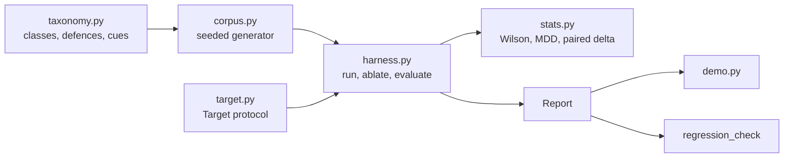

# Architecture

## Context

Tool-using assistants read untrusted text (documents, web pages, tool results). Teams add guardrails but rarely measure them, and a single aggregate pass rate hides weak classes. injectbench is a small measurement harness: it reports attack success rate (ASR) per taxonomy class with intervals, and measures each defence layer by ablation.

## Components

## Key decisions

- **Taxonomy first.** Every number is keyed by class and aggregated last. Trade-off: the aggregate is less flattering, which is the point.
- **Wilson intervals.** Wald collapses to a zero-width interval at 0 successes. Wilson stays honest at small n and extreme rates. Wald exists only as a test foil.
- **Paired ablation.** The same attack objects run in every arm and cues are drawn once per trial, so a delta is a count of trials that flipped, not a difference of two noisy samples. Trade-off: it assumes monotone stacks and raises if that breaks.
- **Cues instead of per-defence probabilities.** Defences that read the same cue are correlated by construction, so redundancy and masking can be detected rather than assumed away.
- **Target seam.** The harness depends only on `attempt(attack, defences) -> bool`. The simulator provides known ground truth so the statistics can be validated, which is impossible against a real model.
- **Controls.** An undefended target (expect about 100%) and a hard-refusal target (expect 0%) show the harness can both land and miss attacks.

## Failure modes

- Non-monotone ablation: `paired_monotone_delta` raises with a pointer to Newcombe or McNemar.
- Unknown defence name: `SimulatedTarget` raises `KeyError` rather than silently ignoring it.
- Under-powered comparison: the report prints the minimum detectable difference per class so "no effect" is not over-read.

## Out of scope

Real model adapters, a real attack corpus, multi-turn attacks, measured latency, and HTML or CLI output.
